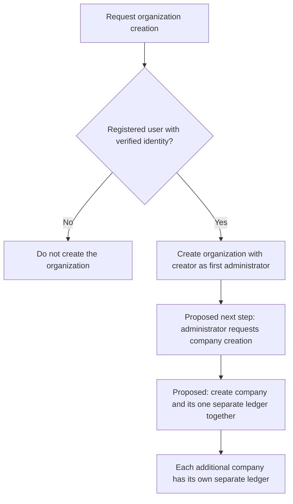
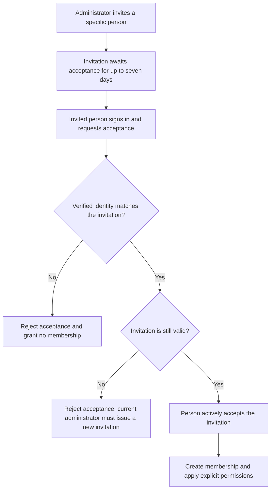
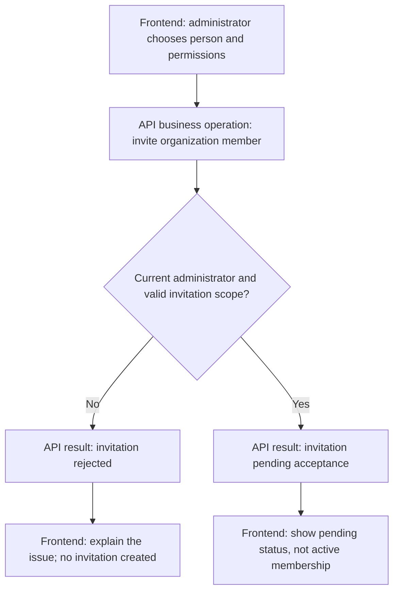
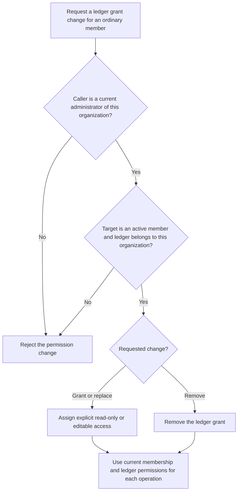
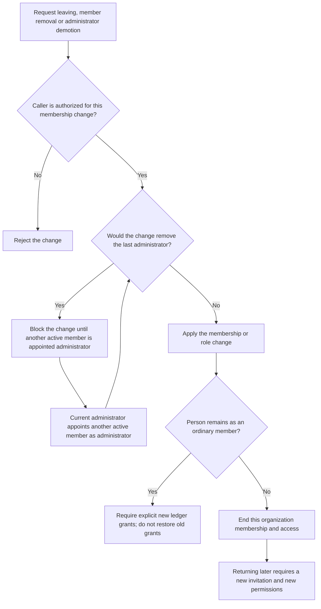
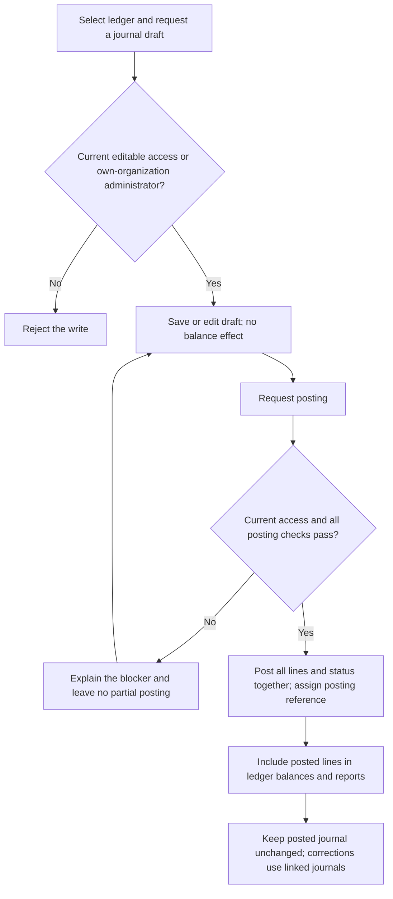
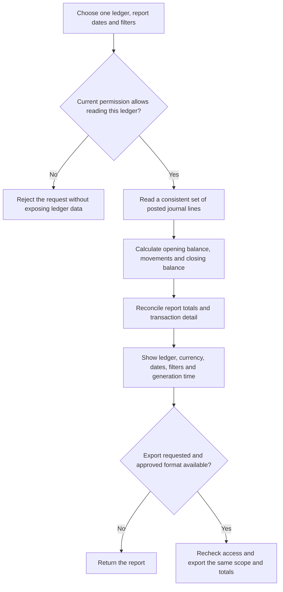

# Business workflows

Status: Review draft. Confirmed rules are labelled below. Proposed workflows and technical mechanisms still need review. These diagrams do not authorize coding, migrations or deployment.

Current sequence: Planning -> Requirements & Workflow -> Technical Design -> Development & Testing. We are reviewing Requirements & Workflow. Existing technical documents remain drafts; detailed technical design is paused.

The diagrams show business steps, not final Frontend layouts or endpoint contracts. Frontend interaction planning and links to API business operations are in scope. Frontend implementation is deferred. API and MCP must use the same backend access rules.

## 1. Create an organization

Confirmed: A registered user with a verified identity can create an organization and becomes its first administrator. A usable organization must not be left without an administrator.

Proposed mechanism: Create the organization and first administrator together, with no partial result or duplicate organization on retry. This diagram does not select a transaction or identity-verification design.

See [Organizations and permissions](02-organizations-permissions.md).

## 2. Create a company and its ledger

Confirmed: One organization can contain several companies. Each company has one independent ledger in the first release. Administrators manage all ledgers in their own organization, not in other organizations.

Proposed workflow: Only an administrator creates a company. Create the company and its one ledger together. Accounting settings are a later accounting-stage proposal, not a new phase-one API requirement.

Proposed steps: Check that the caller is a current administrator of this organization, create the company and ledger together, and return one clear result. A failure or retry must not leave a usable partial company or duplicate ledger. Complete agreed ledger settings before later accounting work.

Ordinary ledger edit access does not allow permission management. The proposed company-creation restriction is separate from that confirmed rule. An organization does not itself keep accounting records or automatically consolidate its companies.

See [Companies and ledgers](03-companies-ledgers.md).

## 3. Invite and join

Confirmed: Only an administrator can invite a specific person. That person must sign in, verify their identity and actively accept before becoming a member. Invitations expire after seven days and can be revoked before acceptance.

- Expired or revoked invitations cannot be accepted.
- If the inviter loses administrator rights, their pending invitations become invalid. Restoring that role does not revive those invitations; a current administrator must invite again.
- Ordinary membership alone gives no ledger access. A user can belong to several organizations, with independent roles and permissions in each.
- A removed member needs a new invitation and explicit new grants. Old invitations and grants must not restore access.

Proposed mechanisms: Accept once, make concurrent acceptance and revocation produce one clear result, and prevent an invitation from silently upgrading an existing member. Revoking an already accepted invitation would not remove the member; member management would handle removal.

### Frontend and API interaction example

Proposed interaction planning, not an approved Frontend or endpoint design:

The invited person must still complete the separate acceptance workflow above.

See [Organizations and permissions](02-organizations-permissions.md).

## 4. Grant or remove ledger access

Confirmed: Only an administrator manages permissions. An ordinary member can hold read-only access to one ledger and editable access to another. Neither kind of access allows delegation.

Administrators already manage every ledger in their own organization and do not need individual ledger grants. Read-only access never permits accounting writes. Editable access remains subject to accounting rules and never permits invitations, role changes or sharing access.

The backend must check membership, organization, ledger and permitted action for every query, write, search and export. API and MCP cannot bypass these checks. Session invalidation, cache behavior, ordering of concurrent writes and revocations, and audit storage are proposed technical mechanisms.

See [Organizations and permissions](02-organizations-permissions.md).

## 5. Leave, remove a member or demote an administrator

Confirmed: Normal membership or role changes must not leave the organization without an administrator. The last administrator must first appoint another active member as administrator.

Only administrators manage other members or their roles. A member leaving one organization keeps their account and any independent access to other organizations. Losing administrator rights also invalidates that person's pending invitations.

The last-administrator rule must hold during concurrent changes. The enforcement mechanism remains proposed.

Security exception: Do not block urgent suspension of a compromised account, even if it is the last usable administrator. A locked-organization recovery process needs separate review before production. Do not silently promote another member. That exception is not the normal leaving workflow above.

See [Organizations and permissions](02-organizations-permissions.md) and [Decisions](10-decisions.md).

## 6. Prepare and post a journal

Proposed accounting workflow: Manual journals can be saved as drafts and posted only after validation. Editors and administrators would prepare and post them; a separate approval role is not assumed. The permission boundary is confirmed, but the posting roles, states and accounting controls still need approval.

Proposed posting checks include an active company, complete ledger settings, a current draft version, eligible same-ledger accounts, at least two non-zero lines, valid debit or credit amounts, exact balance at agreed precision, and a valid accounting date in an open period. A cancelled or already posted draft cannot post again.

A retry must not create a second posting. An uncertain response requires checking the saved outcome before starting a new request. A reversal would be a separate validated journal; it affects balances only when posted and does not erase the original.

This proposal does not add accounting endpoints to phase one or settle currency, precision, numbering, period closure or approval policy.

See [Journals and posting](05-journals-posting.md).

## 7. Read balances and reports

Confirmed: Reading and exporting require access to the specific ledger. Read-only members can read their assigned ledgers. Administrators have access only within their own organization. There is no automatic consolidated organization report.

Proposed accounting workflow: Reports use posted journal lines and one consistent reporting snapshot. Report selection, calculations and export formats still need approval.

Drafts and cancelled drafts would not affect balances. Original entries and posted reversals would both count on their own accounting dates. Opening-balance journals would be included once. Pagination would not change totals; an export download would require current access.

Trial balance and account detail are proposed reconciliation references. Balance sheet and income statement layouts remain drafts until account classification, current-year profit and year-end rules are agreed. No statutory or tax compliance is claimed.

See [Balances and reports](06-reports.md).

## Review boundary

These are process illustrations, not implemented behavior or executed tests. Technical proposals remain subject to the design review. Accounting proposals remain subject to business approval. Frontend implementation is deferred. Interaction planning does not approve final Frontend layouts or technical contracts.

[Documentation index](README.md) · [Decisions](10-decisions.md)
