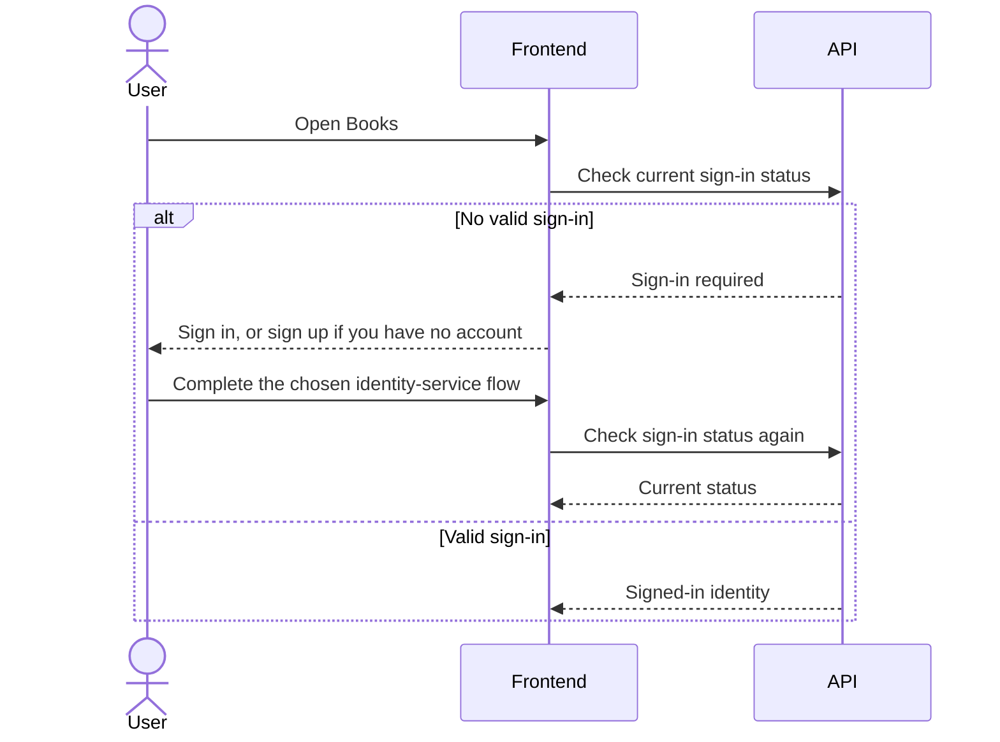
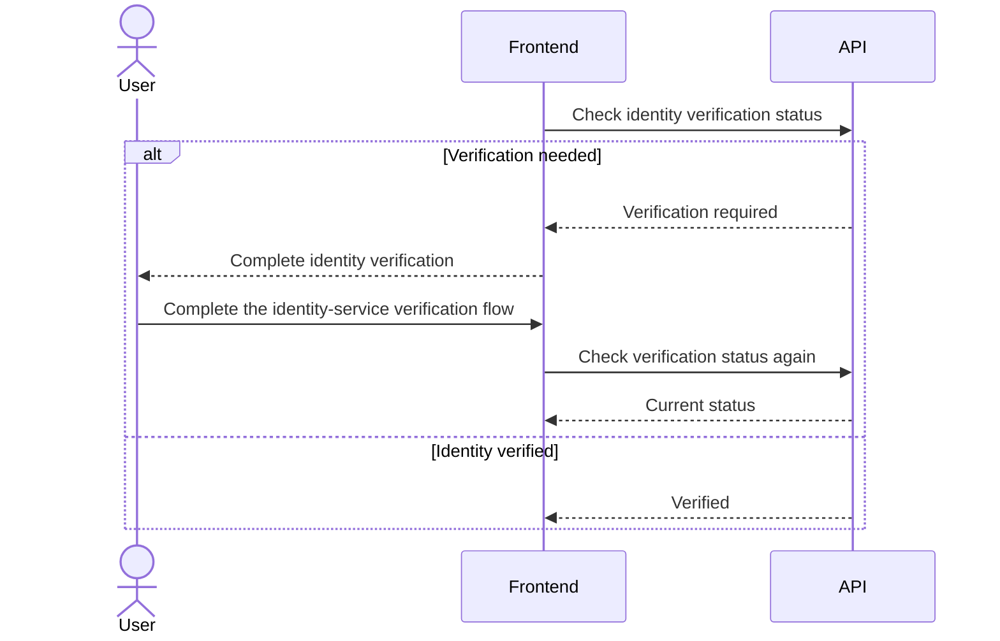
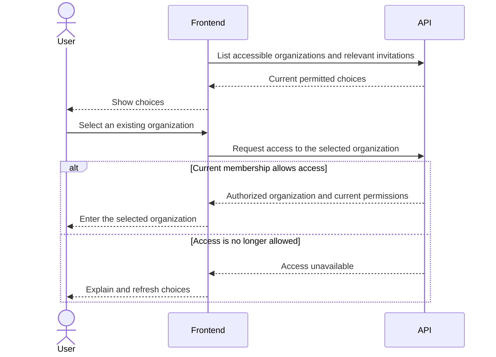
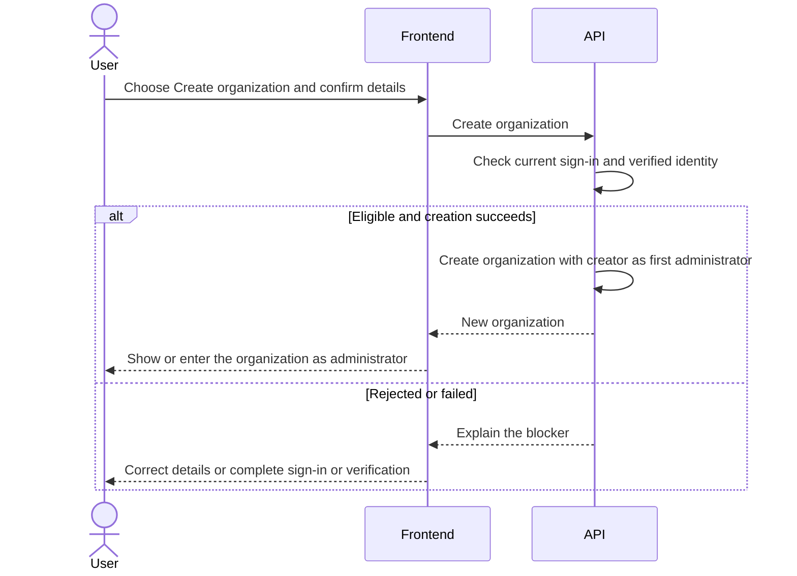
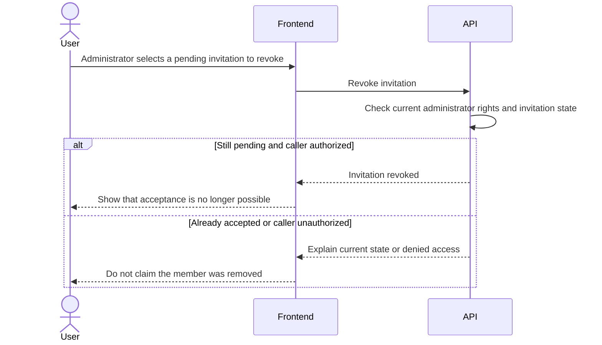
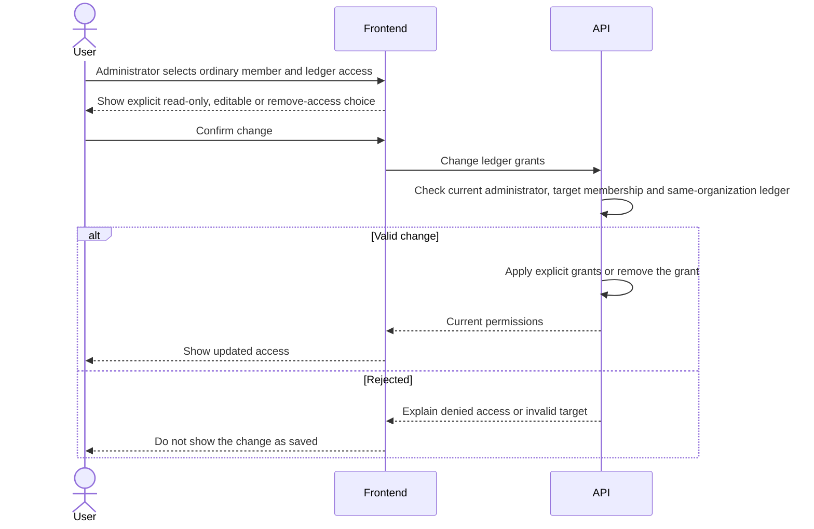
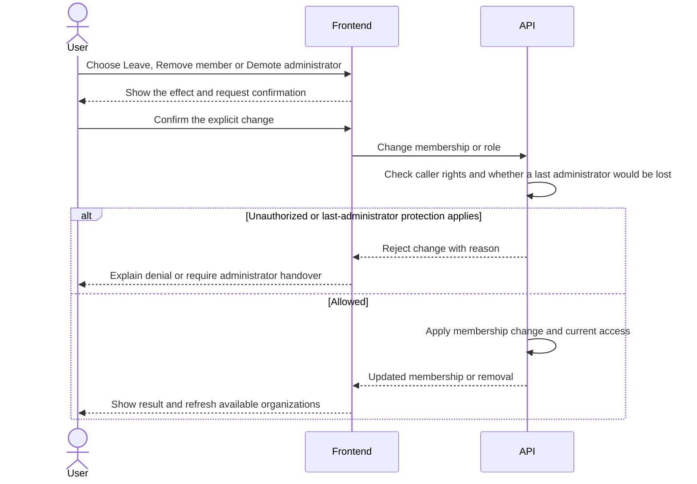
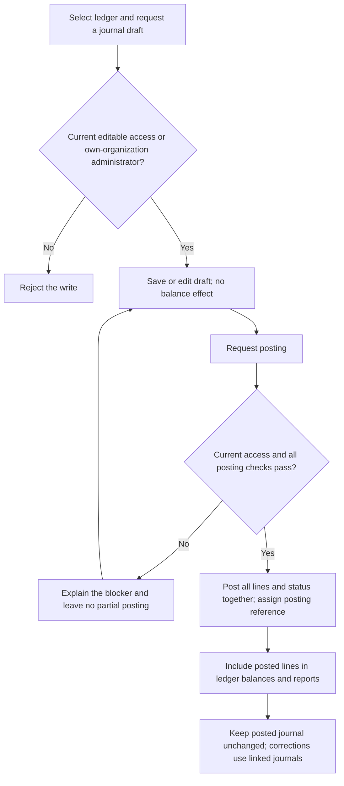
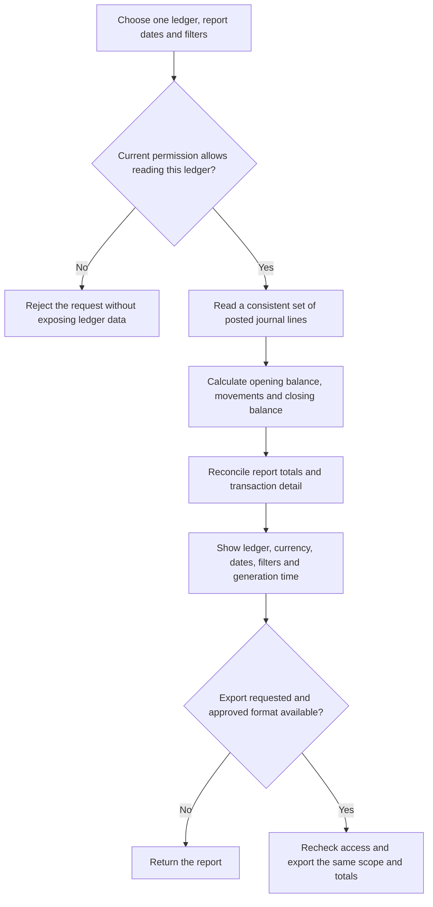

# Business workflows

Status: Review draft. Confirmed rules are labelled below. Proposed workflows and technical mechanisms still need review. These diagrams do not authorize coding, migrations or deployment.

Current sequence: Planning -> Requirements & Workflow -> Technical Design -> Development & Testing. We are reviewing Requirements & Workflow. Existing technical documents remain drafts; detailed technical design is paused.

The diagrams show business steps, not final Frontend layouts or endpoint contracts. Frontend interaction planning and links to API business operations are in scope. Frontend implementation is deferred. API and MCP must use the same backend access rules.

## First-phase workflow index

- [Sign in and select an organization](#enter-books)
- [Create an organization](#explicitly-create-an-organization)
- [Create a company and its ledger](#2-create-a-company-and-its-ledger)
- [Send, accept or revoke an invitation](#3-invite-and-join)
- [Grant or remove ledger access](#4-grant-or-remove-ledger-access)
- [Leave, remove a member or hand over administration](#5-leave-remove-a-member-or-demote-an-administrator)

The interaction diagrams are proposals around the confirmed business rules. API names describe business operations, not new technical contracts. The accounting diagrams below remain separate proposals; this update does not change them.

## 1. Sign in, choose an organization, or create one

Confirmed: A registered user with a verified identity may explicitly create an organization. After successful creation, that user is its first administrator. Signing in is not organization creation.

### Enter Books

Proposed interaction planning. Each diagram separates who acts:
- **User:** chooses what to do.
- **Frontend:** presents choices and results.
- **API:** checks trusted identity and current access.

API labels below are business operations, not final URLs or fields. Sign-in and verification use the future identity service; these diagrams do not make Books the password handler or choose an authentication provider.

#### A. Check sign-in



Continue to B only after sign-in succeeds. A failed or cancelled sign-in stays at this step. An expired session requires sign-in again, not another account or organization.

#### B. Verify identity and show choices



Continue only when the API confirms verification. Otherwise explain what is still needed. Then request accessible organizations and relevant invitations and show three separate choices:
1. Select an existing organization using C.
2. Review and explicitly accept a valid invitation using section 3.
3. Explicitly choose Create organization using the separate flow below.

An empty organization list is a normal result. It does not create an organization or accept an invitation automatically.

#### C. Select an existing organization



The API checks current access, even if the organization appeared in an earlier list. Selection does not create an organization, change membership or carry permissions from another organization. Each later operation still needs its own access check.

A pending invitation is not membership. A person who already belongs to an organization may also explicitly create a different organization under the confirmed creation policy.

### Explicitly create an organization



Creation fields remain proposed. A failure never grants administrator rights. If the response is lost, check the outcome rather than starting a new creation request blindly.

Proposed mechanism: Organization and first-administrator creation succeed together, with no partial result or duplicate organization on retry. A timeout is not proof that creation failed. Company creation is a separate explicit action in section 2; it is not a side effect of sign-in.

### How Books recognizes existing records

Books recognizes the signed-in account, then finds that account's current organization memberships. Each existing organization has its own identifier. A matching organization or company name does not identify the account or prove membership.

The existing [identity proposal](design/phase-1-technical-contract.md#4-identity-and-authentication) maps the identity provider's stable issuer and subject to a Books user ID. Email or display-name matches must not merge accounts. This is a reference to the existing draft, not a new provider choice or verified integration.

See [Organizations and permissions](02-organizations-permissions.md) and [acceptance checks](08-testing-acceptance.md).

## 2. Create a company and its ledger

Confirmed: One organization can contain several companies. Each company has one independent ledger in the first release. Administrators manage all ledgers in their own organization, not in other organizations.

Proposed workflow: Only an administrator creates a company. Create the company and its one ledger together. Accounting settings are a later accounting-stage proposal, not a new phase-one API requirement.

Proposed steps: Check that the caller is a current administrator of this organization, create the company and ledger together, and return one clear result. A failure or retry must not leave a usable partial company or duplicate ledger. Complete agreed ledger settings before later accounting work.

```mermaid
sequenceDiagram
    actor U as User
    participant F as Frontend
    participant A as API
    U->>F: Select organization and choose Create company
    F-->>U: Show proposed company details for review
    U->>F: Confirm creation
    F->>A: Create company in selected organization
    A->>A: Check current administrator access and submitted details
    alt Authorized and creation succeeds
        A->>A: Create company and its one ledger together
        A-->>F: Company and ledger
        F-->>U: Show the created company and ledger
    else Rejected or failed
        A-->>F: Explain the blocker
        F-->>U: Show no successful creation; allow correction
    end
```

The exact required company fields and later accounting settings are not approved by this diagram. If the response is uncertain, check the saved outcome before retrying; never leave a company with two ledgers.

Ordinary ledger edit access does not allow permission management. The proposed company-creation restriction is separate from that confirmed rule. An organization does not itself keep accounting records or automatically consolidate its companies.

See [Companies and ledgers](03-companies-ledgers.md).

## 3. Invite and join

Confirmed: Only an administrator can invite a specific person. That person must sign in, verify their identity and actively accept before becoming a member. Invitations expire after seven days and can be revoked before acceptance.

### Send an invitation

Proposed interaction. Here User is the administrator; below, User is the invited person.

```mermaid
sequenceDiagram
    actor U as User
    participant F as Frontend
    participant A as API
    U->>F: Choose Invite member and explicit role and permissions
    F->>A: Invite organization member
    A->>A: Check current administrator rights and invitation scope
    alt Valid request
        A-->>F: Invitation pending acceptance, with expiry
        F-->>U: Show pending status, not active membership
    else Rejected
        A-->>F: Explain invalid access or details
        F-->>U: Show the issue; no new membership
    end
```

### Accept an invitation

```mermaid
sequenceDiagram
    actor U as User
    participant F as Frontend
    participant A as API
    U->>F: Sign in and choose an invitation to accept
    F-->>U: Show organization and proposed access
    U->>F: Explicitly accept
    F->>A: Accept invitation
    A->>A: Check verified target identity and current invitation validity
    alt Valid acceptance
        A->>A: Add membership with explicit permissions once
        A-->>F: Membership and current access
        F-->>U: Show the joined organization
    else Expired, revoked, invalidated or wrong identity
        A-->>F: Reject acceptance
        F-->>U: Explain why; no access granted
    end
```

- Expired or revoked invitations cannot be accepted.
- If the inviter loses administrator rights, their pending invitations become invalid. Restoring that role does not revive those invitations; a current administrator must invite again.
- Ordinary membership alone gives no ledger access. A user can belong to several organizations, with independent roles and permissions in each.
- A removed member needs a new invitation and explicit new grants. Old invitations and grants must not restore access.

Proposed mechanisms: Accept once, make concurrent acceptance and revocation produce one clear result, and prevent an invitation from silently upgrading an existing member. Revoking an already accepted invitation would not remove the member; member management would handle removal.

### Revoke an invitation



Invitation discovery and notification remain proposed: an authenticated inbox is the existing suggestion, not a promise of email delivery. Revocation cannot undo a completed membership; use member removal instead. Concurrent acceptance and revocation must have one clear outcome.

See [Organizations and permissions](02-organizations-permissions.md).

## 4. Grant or remove ledger access

Confirmed: Only an administrator manages permissions. An ordinary member can hold read-only access to one ledger and editable access to another. Neither kind of access allows delegation.



Administrators already manage every ledger in their own organization and do not need individual ledger grants. Read-only access never permits accounting writes. Editable access remains subject to accounting rules and never permits invitations, role changes or sharing access.

The backend must check membership, organization, ledger and permitted action for every query, write, search and export. API and MCP cannot bypass these checks. Session invalidation, cache behavior, ordering of concurrent writes and revocations, and audit storage are proposed technical mechanisms.

See [Organizations and permissions](02-organizations-permissions.md).

## 5. Leave, remove a member or demote an administrator

Confirmed: Normal membership or role changes must not leave the organization without an administrator. The last administrator must first appoint another active member as administrator.

### Request a membership change

User means the member leaving, or an administrator managing another member.



For a demotion, the request must explicitly state new ledger grants; an empty list means no ledger access. Removal ends access to this organization, including from an existing session. Neither action restores historical grants.

### Hand over before the last administrator leaves

```mermaid
sequenceDiagram
    actor U as User
    participant F as Frontend
    participant A as API
    U->>F: Last administrator selects another active member
    F-->>U: Confirm promotion to administrator
    U->>F: Confirm
    F->>A: Promote selected member
    A->>A: Check current administrator and active target membership
    alt Promotion succeeds
        A-->>F: Another administrator is now active
        F-->>U: Handover succeeded; you may request leaving or demotion
        U->>F: Explicitly request leaving or demotion
        F->>A: Apply membership change with fresh checks
        A-->>F: Result after rechecking administrator protection
        F-->>U: Show actual result
    else Promotion fails
        A-->>F: Explain failure
        F-->>U: Remain administrator; do not proceed as if handover succeeded
    end
```

Only administrators manage other members or their roles. A member leaving one organization keeps their account and any independent access to other organizations. Losing administrator rights also invalidates that person's pending invitations.

The last-administrator rule must hold during concurrent changes. The enforcement mechanism remains proposed.

Security exception: Do not block urgent suspension of a compromised account, even if it is the last usable administrator. A locked-organization recovery process needs separate review before production. Do not silently promote another member. That exception is not the normal leaving workflow above.

See [Organizations and permissions](02-organizations-permissions.md) and [Decisions](10-decisions.md).

## Account maintenance workflows

- [Edit Account](#8-edit-account)
- [Deactivate Account](#9-deactivate-account)
- [Delete Account](#10-delete-account)

These are operation workflows, not a COA classification flowchart. The account tree remains in the COA document. Restrictions beyond confirmed fields remain Proposed.

## Remaining business choices for these workflows

- Which organization and company details should users supply at creation? Field requirements remain proposed.
- Is an authenticated invitation inbox enough initially, or do users also need email notifications? No delivery method is confirmed.

These choices do not reopen the confirmed roles, seven-day invitation policy, membership rules or administrator handover. API paths, schema and authentication mechanisms are engineering tasks for the later design stage, not owner questions.

## 6. Prepare and post a journal

Proposed accounting workflow: Manual journals can be saved as drafts and posted only after validation. Editors and administrators would prepare and post them; a separate approval role is not assumed. The permission boundary is confirmed, but the posting roles, states and accounting controls still need approval.



Proposed posting checks include an active company, complete ledger settings, a current draft version, eligible same-ledger accounts, at least two non-zero lines, valid debit or credit amounts, exact balance at agreed precision, and a valid accounting date in an open period. A cancelled or already posted draft cannot post again.

A retry must not create a second posting. An uncertain response requires checking the saved outcome before starting a new request. A reversal would be a separate validated journal; it affects balances only when posted and does not erase the original.

This proposal does not add accounting endpoints to phase one or settle currency, precision, numbering, period closure or approval policy.

See [Journals and posting](05-journals-posting.md).

## 7. Read balances and reports

Confirmed: Reading and exporting require access to the specific ledger. Read-only members can read their assigned ledgers. Administrators have access only within their own organization. There is no automatic consolidated organization report.

Proposed accounting workflow: Reports use posted journal lines and one consistent reporting snapshot. Report selection, calculations and export formats still need approval.



Drafts and cancelled drafts would not affect balances. Original entries and posted reversals would both count on their own accounting dates. Opening-balance journals would be included once. Pagination would not change totals; an export download would require current access.

Trial balance and account detail are proposed reconciliation references. Balance sheet and income statement layouts remain drafts until account classification, current-year profit and year-end rules are agreed. No statutory or tax compliance is claimed.

See [Balances and reports](06-reports.md).

## 8. Edit Account

Status: Proposed workflow. Confirmed fields include editable Code unique within the ledger, optional Description, Sort Order and Default Usage as subsystem + purpose. Exact account-edit permissions and structural restrictions below remain proposals.

```mermaid
sequenceDiagram
    actor U as User
    participant F as Frontend
    participant A as API
    U->>F: Open account and choose Edit
    F->>A: Read account with current ledger access
    A-->>F: Authorized account details or access denied
    F-->>U: Show editable details only if authorized
    alt User cancels
        U->>F: Cancel
        F-->>U: Discard unsaved changes
    else User saves
        U->>F: Submit intended changes
        F->>A: Edit account
        A->>A: Check current edit access, unique Code and current record
        A->>A: Check history, structural changes and active mappings
        alt Valid change
            A-->>F: Saved account
            F-->>U: Show saved values
        else Denied, invalid or concurrent conflict
            A-->>F: Explain the blocker
            F-->>U: Keep edits for review; do not claim success
        end
    end
```

Proposed rules:
- Ledger editors or organization administrators may edit; read-only members may not. The API rechecks access when saving.
- Existing transactions do not by themselves block Name, Code, Description or Sort Order changes. Code remains unique within its ledger. Account ID and historical journal references stay unchanged.
- Before first use, structural corrections still require valid references and classifications. After use, reject unsupported Type/parent changes; changing a System Purpose or any future account currency needs a separately approved safe policy. This does not add an account-currency field.
- Validate Default Usage subsystem + purpose. If an active function relies on a System/default mapping, validate its replacement before removing or changing that mapping. Do not silently break other records or enable a new subsystem.
- A conflicting edit must not overwrite a newer save. Let the user refresh and reconcile their changes. If a response is lost, check the saved state before retrying or showing success.

[Account rules](04-chart-of-accounts.md#proposed-create-change-and-deactivate)

## 9. Deactivate Account

Status: Proposed workflow and deactivation policy. Deactivation stops new use; it does not delete transactions or remove the account from historical reports.

```mermaid
sequenceDiagram
    actor U as User
    participant F as Frontend
    participant A as API
    U->>F: Choose Deactivate account
    F->>A: Review current account and dependencies
    A-->>F: Authorized details or access denied
    F-->>U: Show impact and required mapping replacements if authorized
    alt User cancels
        U->>F: Cancel
        F-->>U: Leave account unchanged
    else User confirms
        U->>F: Confirm deactivation
        F->>A: Deactivate account
        A->>A: Recheck edit access, current state and references
        alt Active required mapping lacks a valid replacement
            A-->>F: Replacement required
            F-->>U: Resolve mapping; account remains active
        else Other validation or concurrent conflict
            A-->>F: Explain the blocker
            F-->>U: Review or refresh; do not claim success
        else Valid deactivation
            A-->>F: Account inactive
            F-->>U: Show inactive status; retain historical access
        end
    end
```

Proposed rules:
- Use the same current ledger-edit permission check as account editing. Recheck dependencies at confirmation, not just when the form opens.
- Permit a remaining balance; do not require or invent a zero balance. Show the balance and impact before confirmation. This nonzero-balance policy is still proposed.
- Replace active required System/default mappings with a valid account before deactivation. Recheck the replacement and protected references; do not silently redirect historical entries.
- Block new postings and new active default use. Existing drafts must be revalidated before posting and corrected if they reference the inactive account.
- Preserve the account identity, transactions, balances and historical reports. A separate authorized reactivation may be proposed; deletion has its own separate eligibility checks below.
- An uncertain response is not success or failure. Check current account state before retrying. Record changes and their outcomes without exposing data from another ledger.

[Account rules](04-chart-of-accounts.md#proposed-create-change-and-deactivate)

## 10. Delete Account

Status: Proposed rules for review. This is a documentation workflow only, not permission to delete any real account. Unlike deactivation, deletion removes an eligible unused account from normal use; it must not erase posted accounting history.

```mermaid
sequenceDiagram
    actor U as User
    participant F as Frontend
    participant A as API
    U->>F: Choose Delete account
    F->>A: Review current account and deletion eligibility
    A-->>F: Eligibility and blockers, only with current access
    F-->>U: Show blockers or ask explicit deletion confirmation
    alt User cancels
        U->>F: Cancel
        F-->>U: Leave account unchanged
    else User confirms an eligible deletion
        U->>F: Confirm Delete
        F->>A: Delete selected unused account
        A->>A: Recheck edit authority, history, references and children
        alt Still eligible
            A->>A: Remove account from normal use and retain audit identity
            A-->>F: Deletion completed
            F-->>U: Show result and refresh account list
        else Now used, referenced, unauthorized or changed
            A-->>F: Reject with current blocker
            F-->>U: Keep account; review current state
        end
    end
```

Proposed rules:
- Allow deletion only if the account has never been used and has no document, System Purpose or Default Usage references.
- Posted history blocks deletion even if the balance is zero. Offer deactivation instead, subject to its own checks.
- A draft or mapping reference must be handled explicitly before eligibility is reconsidered. Do not remove references silently.
- A Group with children cannot be deleted directly or by an automatic cascade.
- Use the proposed current account-edit authority check and recheck after confirmation. A preview does not reserve eligibility against concurrent posting or edits.
- Keep audit evidence and the stable identity needed to explain what happened. Do not recycle that identity. Soft versus hard deletion, retention and recovery are later design choices, not promised behavior.
- A lost response requires checking the outcome before retrying. Do not show deletion as successful without confirmation.

[Account rules](04-chart-of-accounts.md#proposed-create-change-and-deactivate)

## Review boundary

These are process illustrations, not implemented behavior or executed tests. Technical proposals remain subject to the design review. Accounting proposals remain subject to business approval. Frontend implementation is deferred. Interaction planning does not approve final Frontend layouts or technical contracts.

[Documentation index](README.md) · [Decisions](10-decisions.md)
